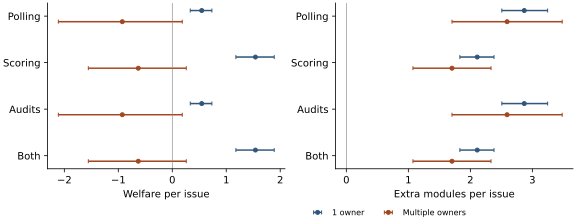

# Historical issue-to-module replay

## Findings

Across 234 later Django issues, the pooled pre-fix benchmark achieved mean welfare of 3.71 units per issue. The issue-text classifier reached 3.54, aligned module polling 2.81, plurality voting 1.32 and the description router 1.24. With six of nine module owners rewarded privately for assignment, strategic polling fell to 0.38. At a budget of one unit per issue, validation selected scoring alone at scale eight. Held-out welfare rose to 1.29. The paired gain was 0.91 units per issue (95% interval 0.58 to 1.25), or 0.51 after centered score transfers (0.10 to 0.93). These figures describe simulated incentives and historical patch coverage in one repository.

| Six acquirers, credit off | Coverage | Mean extra modules | Issues with extra modules | Welfare |
|---|---:|---:|---:|---:|
| Polling | 47.0% | 2.84 | 52.6% | 0.38 |
| Scoring, scale eight | 48.7% | 2.06 | 56.8% | 1.29 |

The scoring gain came mainly from assignment cost. Relative to the pooled benchmark, excess cost fell from 0.97 to 0.20 units and miss loss fell from 2.36 to 2.22. The frequency of padding rose even as its mean size fell. On the 27 multi-module issues, polling covered 9 fixes and scoring covered 6. The corresponding 95% coverage intervals were 19–52% and 11–41%. These small counts limit any conclusion about coalition coverage. [Method estimates and intervals](methods.csv)

With scoring fixed at two and audit probability at 0.25, equal-split credit covered 61.5% of issues and added 3.75 extra modules per issue under six acquirers. With credit off the corresponding figures were 18.8% and 0.92. Under Shapley credit the reporting solver hit its iteration limit in this condition, with an available deviation worth 0.169 units. Its terminal coverage and padding are descriptive only. Across the primary matrix, 39 of 44 profiles met the empirical convergence criterion. A second initialization of the scale-two combined mechanism also converged and changed assignments on 52 issues. [Solver diagnostics](diagnostics.json)

In the credit-off acquisition sweep, adding modeled audits left assignments unchanged and cost 0.225 units per issue at the 0.25 audit rate. Agents could shade probabilities with genuine payloads. No contradicted payloads occurred in those conditions, so the sweep supplies no evidence of deterrence against pure shading. A separate source pilot confirmed 24 genuine import citations and rejected 24 deliberately altered citations to the same source lines. This is an implementation check on selected, checkable claims. Estimating realistic neighbor detection probabilities would require independently sampled claims and manipulations. [Source checks](source-check.json)

The independent type-draw check produced positive gross gains at all five seeds. Four scoring profiles converged, with mean gains of 0.80–1.15. The fifth cycled. Bootstrap intervals condition on the fitted models, policy, and type draw. [Seed sensitivity](seed-sensitivity.csv)

For the single-owner, six-acquirer comparison, the synthetic runner ordered voting, descriptions, then polling by welfare at each of three seeds. The grounded single-owner slice gave the same order, with welfare 1.63, 1.43 and 0.55 respectively. The two runners use different evidence and reporting models. The synthetic oracle sees ownership directly, so its welfare is excluded from this comparison. [Synthetic comparison](synthetic.csv)

## Cohort and information available to each agent

The input is the full benchmark's published test shard, restricted to its 850 Django pull requests. The replay defines its own chronological partitions. Nine module agents represent models, database backends, administration, remaining contributed packages, core, forms, templates, utilities and remaining package code. Match the first eligible path prefix in the manifest. Files under the shipped Django package with a Python suffix qualify. Production changes outside Python are outside the proxy. For a rename, consider both paths. The six excluded repeated issue texts used the same whitespace-normalized report as an earlier eligible case. Historical fixes can differ from other valid ways to resolve an issue. [Cohort and ownership labels](cohort.csv) · [Exclusions](excluded.json)

The replay time is the later of benchmark creation and base-commit time. The fix must merge after that time. Training fixes must also merge before 1 January 2021 UTC, and validation fixes before 1 January 2022 UTC. This yielded 429 training, 181 validation and 234 held-out issues. The held-out set contained 207 fixes touching one module, 23 touching two, three touching three and one touching four. There were no identical patch texts across partitions. The benchmark supplies the issue text as collected. Its edit history is unavailable, so the replay cannot establish when every sentence was first visible. [Pinned corpus](https://huggingface.co/datasets/SWE-bench/SWE-bench/tree/c6fe717fd7a4c3ac1daa4055a4fd082c6a1d28a2)

Agents match issue terms, symbols, dotted module mentions and file paths against their own source at the recorded base commit. Absolute and relative static imports form directed citations. Distinct adjacent modules define undirected audit degree. Seven file-snapshot parses could only contribute lexical features. Dynamic imports and runtime dependencies fall outside the graph. The catch-all module and one reference document per group are coarse approximations. [Module map and document revisions](manifest.json)

Each module uses a standardized logistic predictor and a sigmoid calibration fit on validation cases. B1 compares the issue against fixed training-era documentation. Its similarity-to-probability map uses earlier labels. B3 gives each voter its own estimate and public training priors for peers. The central classifier sees only issue text. B4 estimates a joint distribution over entire training ownership sets using the 25 nearest earlier issues under pooled module features and text similarity. It evaluates all 512 assignments. Its observed welfare can fall below another method's on a held-out slice. The module predictors had Brier loss 0.0855 and ten-bin calibration error 0.0182. The central classifier had 0.0746 and 0.0343. [Calibration by module](calibration.csv)

## Reporting game and interpretation

Every issue uses conjunctive selection, including single-owner fixes. A unit assignment cost and resolution reward of eight apply in the primary comparisons. Reward sensitivities use five and twelve. Equation 2 uses the product approximation for report-based selection. Equal costs permit an exact search over the best set at each cardinality by sorting the reports. The pooled benchmark uses empirical joint coverage. Welfare is resolution reward minus the number of assigned modules. Efficiency uses the ratio of mean welfares when the benchmark mean is positive.

Private type draws choose exactly zero, three or six agents per issue. Types stay fixed across paired methods. An agent observes its module, its private type and a low/high local-belief bin. It can transmit its continuous local estimate or choose a constant on a 0.05 grid. The scoring term uses its own belief for expected Brier loss. Empirical validation cases in the same information bin supply assignment and credit expectations. Agents can attach an altered payload independently of the numerical report. A contradiction costs two units and replaces the selection input with the public module prior. Settlement scores the original report. The audit detection model uses the real graph degree, audit rate and assumed per-neighbor detection probability. The primary detection probability is 0.4, with checks at 0.1 and 0.8.

Coordinate best responses stop after a stable pass, a repeated profile or twenty passes. The residual is the largest remaining conditional gain from a unilateral deviation in the finite action space. A stable empirical profile can depend on initialization, sample size and binning. Credit off, equal split and assigned-set Shapley use the same scoring and audit settings for their comparison. Private incentives and credit transfers are separate from welfare. The budget charges signed centered score transfers plus expected audit expenditure. A negative transfer is possible. Fines and credit are recorded separately.

The frontier chooses the converged configuration with least validation gap under each budget and evaluates that choice on later issues. A realized held-out cost can cross the planned budget. Issue-paired bootstrap intervals use 2,000 resamples for welfare differences, recovery and mean padding. Coverage and the probability of any padding use Wilson intervals. The output counts one message per submitted report or vote and two per checked neighbor for audit requests and responses. Public central and description routing use zero agent messages. Conjunctive assignment has no escalation hops. [Budget frontier](frontier.csv) · [Issue-level replay](replay.csv.gz)

The leakage check changed a real three-module patch label to a different module, re-extracted the pre-fix evidence and refit the models. All fixed baseline assignments and all strategic reports and assignments in the checked condition were identical across the full held-out set. The revealed ownership changed at settlement. [Perturbation check](leakage-check.json)
